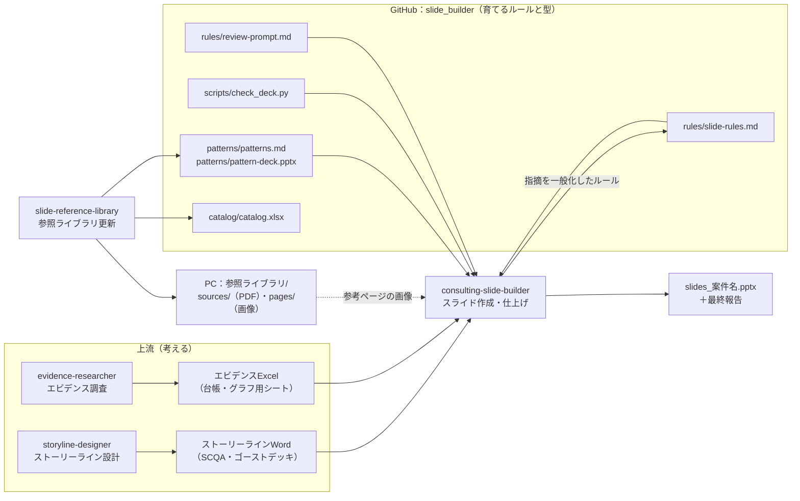
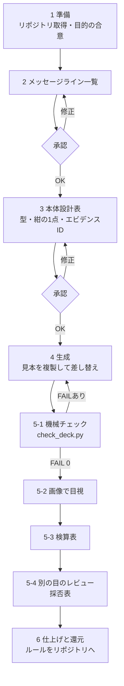

# スキルの処理の流れ

3つのスキルとこのリポジトリが、何を入力に、どのファイルの何を参照し、何をするかをまとめる。

## 全体像

## consulting-slide-builder の手順

| 手順 | 入力 | 参照するファイルと箇所 | 処理 | 出力・関門 |
| --- | --- | --- | --- | --- |
| 1 準備 | 依頼内容、テンプレート（任意） | `rules/slide-rules.md` 全文（特に「着手前の確認」）、`patterns/patterns.md` | リポジトリを取得し、目的・成果物・範囲を3〜5行で合意する | 合意した目的 |
| 2 メッセージライン | ストーリーラインWord | `rules/slide-rules.md` A章（2行・20pt、事実＋示唆、単独で読める） | ゴーストデッキのタイトルを磨き、一覧にして10秒テスト | **承認**：メッセージライン一覧 |
| 3 本体設計 | メッセージライン一覧、エビデンスExcel | `patterns/patterns.md`（型・紺にする1点・密度）、`catalog/catalog.xlsx` と PCの `pages/`（参考ページ） | スライドごとに型・チャート・紺の1点・エビデンスIDを決める | **承認**：本体設計表 |
| 4 生成 | 本体設計表、エビデンスExcelの値 | `patterns/pattern-deck.pptx`（同じIDの見本）、`rules/slide-rules.md` B〜D章 | 見本を複製して中身を差し替え、章ごとに3〜4枚ずつ作る | 下書きのpptx |
| 5 仕上げ | 下書きのpptx | `scripts/check_deck.py`、`rules/slide-rules.md` D-4、`rules/review-prompt.md` | 機械チェック（FAIL 0）→ 画像で目視 → 検算表 → 別のエージェントのレビューと採否表 | 仕上がったpptx |
| 6 還元 | ユーザーとレビューの指摘 | `rules/slide-rules.md` G章、`scripts/check_deck.py`、`rules/review-prompt.md` | 指摘を1行のルールに一般化し、了承を得てリポジトリに追記・コミット | **承認**：追加ルール、CHANGELOG |

## slide-reference-library の手順

| 手順 | 入力 | 参照・更新するファイル | 処理 |
| --- | --- | --- | --- |
| 1 候補 | ウェブ検索 | `catalog/catalog.xlsx`「収集候補」 | 公開資料の書誌情報・URLを追記 |
| 2 取得 | 候補のURL | PCの `sources/`・`pages/` | PCでPDFを保存し、ページを画像にする（リポジトリには入れない） |
| 3 分類 | ページ画像 | `catalog/catalog.xlsx`「ページ台帳」 | 型・章・評価（A/B/C）・学べる点を記録 |
| 4 型の更新 | ページ台帳 | `patterns/patterns.md` | 評価Aを参考ページIDに登録、密度の目安・失敗例を更新、新しい型を提案 |
| 5 見本の再生成 | patterns.md | `scripts/build_pattern_deck*.js` → `patterns/pattern-deck.pptx` | 型を追加したときだけ再生成し、check_deck.py --sample で確認 |
| 6 反映 | 差分 | `CHANGELOG.md` | 他社資料が混ざっていないか確認してコミット |
